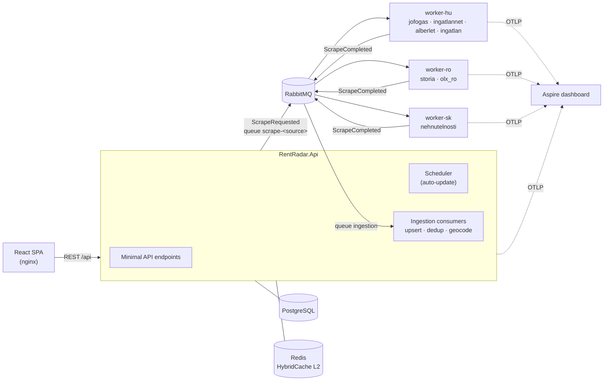

# Rent Radar

[](https://github.com/rem700/rent-radar/actions/workflows/ci.yml)
· [Live demo](https://rem700.github.io/rent-radar/) (UI with sample data)

A self-hosted rental search for Hungary, Romania and Slovakia. You save a search — **country, city, filters** — and
the system queries every rental site it knows for that country, merges the listings into one feed, removes
duplicates across sites, places them on a map and keeps checking for new ones.

Built as a small distributed system: an **ASP.NET Core API**, **scraper workers** that scale per country, a
**RabbitMQ** message bus (MassTransit), **PostgreSQL**, **Redis** and **OpenTelemetry**, with a **React + TypeScript**
front end. The same code also runs as one process with SQLite and an in-memory bus, so trying it needs nothing but
the .NET SDK and Node.js.

## Architecture



**Flow of one search run**

1. The scheduler (or `POST /api/searches/{id}/run`) creates a `SourceRun` row per matching source and sends a
   `ScrapeRequested` command to that source's queue, e.g. `scrape-jofogas`.
2. A worker that serves the source picks it up, pages through the site and publishes `ScrapeCompleted` with the raw
   listings — or with the error text if the site failed. A broken site never fails the run of the others.
3. The ingestion consumer converts prices to EUR, upserts listings (price history, removed-listing flags), attaches
   each new listing to a duplicate from another site or to a new property, and closes the run.
4. When the last run of the search closes, a `SearchEnrichmentRequested` event geocodes listings without coordinates
   (Nominatim, ≤ 1 request/s) in small batches and merges listings that now match a duplicate.

**Design decisions**

| Decision | Why |
|---|---|
| One queue per source, `ConcurrentMessageLimit = 1` | Workers are deployed per country (`Worker:Sources`), and a site is never hit by parallel runs from one worker. Adding capacity for a slow site means adding a consumer to its queue. |
| Commands to queues, results as events | The API does not know which worker serves which source; any number of workers can answer. |
| Idempotent ingestion keyed by `RunId` | A redelivered `ScrapeCompleted` is ignored once the run is closed; unique index on `(search, source, external id)`. |
| Ingestion and enrichment share one queue with concurrency 1 | Writes for a search never race, and the geocoder's rate limit holds without a distributed lock. |
| Runs that nobody answers are closed after 30 min | If no worker serves a source, the search does not look busy forever and the UI shows why. |
| HybridCache (memory + Redis) for exchange rates | One download per 12 h shared by all API replicas; built-in approximate rates if the rate service is down. |
| Same EF Core model on PostgreSQL and SQLite | Distributed and single-process modes share all code; nested values (filters, photos, price history) are JSON text. |
| Domain logic in a dependency-free project | Parsing helpers, filters and duplicate detection are pure functions with unit tests. |

## Running it

### Single process (Windows, no Docker)

Needs the [.NET 10 SDK](https://dotnet.microsoft.com/download) and Node.js 20+. Double-click **`start.bat`**: it
starts the API (with the scrapers in-process, SQLite in `src/RentRadar.Api/data/`) and the Vite dev server, then opens
http://localhost:5173.

Manually, on any OS:

```bash
cd src/RentRadar.Api && dotnet run          # http://127.0.0.1:8000
cd web && npm install && npm run dev        # http://localhost:5173 (proxies /api)
```

### Distributed (docker compose)

```bash
docker compose up --build
```

| URL | What |
|---|---|
| http://localhost:8080 | the app (nginx serving the SPA and proxying `/api`) |
| http://localhost:8000/openapi/v1.json | OpenAPI document of the API |
| http://localhost:18888 | traces, metrics and logs of every service (Aspire dashboard) |
| http://localhost:15672 | RabbitMQ management (guest / guest) |

Health checks: `/health/live` (process) and `/health/ready` (database, cache, message bus).

## Sources

| Source | Site | Country | How it reads | Checked |
|---|---|---|---|---|
| `jofogas` | ingatlan.jofogas.hu | HU | JSON embedded in the results page (Next.js `__NEXT_DATA__`): price, parameters, coordinates, pets, furniture | 09.11.2026 |
| `ingatlannet` | ingatlannet.hu | HU | `__NEXT_DATA__` JSON; geocoded by address | 10.11.2026 |
| `alberlet` | alberlet.hu | HU | result cards (AngleSharp), with a link-based fallback parser | 14.11.2026 |
| `ingatlan` | ingatlan.com | HU | **e-mail alerts** read over IMAP (MailKit) from a Gmail label — not the website | 14.11.2026 |
| `storia` | storia.ro | RO | `__NEXT_DATA__` JSON: price, rooms, size, floor, street, sector, photos | 14.11.2026 |
| `olx_ro` | olx.ro | RO | result cards; rooms parsed from the title | 14.11.2026 |
| `nehnutelnosti` | nehnutelnosti.sk | SK | schema.org JSON-LD + address from the card | 14.11.2026 |
| `demo` | — | any | generated sample data, used when a country has no real source | — |

The scrapers respect robots.txt and do not work around bot protection. ingatlan.com disallows crawling its result
pages, so it is connected through the site's own saved-search e-mails. Not connected for the same reasons:
imobiliare.ro (403 to non-browser clients), reality.bazos.sk (filters disallowed in robots.txt).

### ingatlan.com e-mail alerts (optional)

1. Save searches with e-mail alerts on ingatlan.com; in Gmail, filter mail from `ingatlan.com` into a label
   (e.g. `rent-finder`) and skip the inbox.
2. Give the service a Google **app password** — never the account password — through user secrets, environment
   variables (`Mail__User`, `Mail__AppPassword`, `Mail__Label`; for docker compose put `GMAIL_USER`,
   `GMAIL_APP_PASSWORD` in a git-ignored `.env`) or a git-ignored `src/RentRadar.Api/appsettings.Local.json`:

   ```json
   { "Mail": { "User": "you@gmail.com", "AppPassword": "xxxx xxxx xxxx xxxx", "Label": "rent-finder" } }
   ```

   `Mail:IniPath` can point to a `mail.ini` from the earlier Python version instead.

### Adding a site

1. Add a class to `src/RentRadar.Scraping/Adapters/` deriving from `SourceAdapter`: set `Name`, `Title`, `Countries`
   and implement `FetchAsync`, which yields `RawListing` objects. Keep the parsing in static methods so it can be
   tested against saved HTML.
2. Register it in `AddScraping` and add its name to `KnownSources`.
3. Add it to a worker's `Worker__Sources` in `compose.yaml`.

Currency conversion, geocoding, de-duplication, filters and the map need no changes.

## Tests

```bash
dotnet test RentRadar.slnx
```

- **Unit tests**: parsing helpers, pets detection in five languages, filters, duplicate rules, and every adapter's
  parser against fragments of the real pages and e-mails.
- **Integration test**: the whole pipeline in one process — `WebApplicationFactory`, in-memory MassTransit transport,
  in-process demo worker, SQLite — from `POST /api/searches` to filtered, sorted properties, favourites and the
  snake_case JSON contract the React client uses.
- **CI** (`.github/workflows/ci.yml`) also builds the React app and runs `scripts/smoke-test.sh` against the full
  `docker compose` stack: API → RabbitMQ → worker → ingestion → PostgreSQL → nginx.

## Project structure

```
src/
  RentRadar.Domain/          parsing helpers, filters, duplicate detection, currencies — no dependencies
  RentRadar.Contracts/       messages: ScrapeRequested, ScrapeCompleted, SearchEnrichmentRequested, RawListing
  RentRadar.Scraping/        source adapters, catalog, scrape consumer, scraper metrics
  RentRadar.ServiceDefaults/ OpenTelemetry, health checks, MassTransit transport selection
  RentRadar.Api/             minimal API, EF Core, ingestion consumers, scheduler, geocoding, exchange rates
  RentRadar.Worker/          scraper worker host
tests/RentRadar.Tests/       xUnit: unit + integration
web/                         React 19, TypeScript, Vite, Ant Design, Leaflet; EN / DE / RU
compose.yaml                 PostgreSQL, RabbitMQ, Redis, Aspire dashboard, API, 3 workers, nginx
```

## Configuration

| Key | Default (single process) | docker compose |
|---|---|---|
| `Database:Provider` | `Sqlite` | `Postgres` |
| `Messaging:Transport` | `InMemory` | `RabbitMq` |
| `Workers:InProcess` | `true` | `false` (separate workers) |
| `Worker:Sources` | `*` | per worker, e.g. `storia,olx_ro` |
| `ConnectionStrings:redis` | — (memory cache) | `redis:6379` |
| `Scheduler:Enabled` | `true` | `true` (keep it on one API replica) |
| `Geocoding:Enabled`, `Currency:Online` | `true` | `true` |

## Limitations and next steps

- The schema is created with `EnsureCreated`; EF Core migrations come next, before the schema changes.
- Exactly one API instance should run the scheduler; leader election (e.g. a PostgreSQL advisory lock) would remove
  that rule.
- Real-site parsers are verified against saved page fragments; sites change their markup, and a failing source shows
  its error in the UI.

## History

This is a rewrite of [rent-finder](https://github.com/rem700/rent-finder) (Python, FastAPI, SQLite, a single process)
as a .NET distributed system. The React client and the REST contract are unchanged.

## Stack

.NET 10 · ASP.NET Core minimal APIs · EF Core (PostgreSQL / SQLite) · MassTransit · RabbitMQ · Redis · HybridCache ·
OpenTelemetry · AngleSharp · MailKit · Polly (Microsoft.Extensions.Http.Resilience) · xUnit · Docker Compose ·
GitHub Actions · React · TypeScript · Vite · Ant Design · Leaflet
